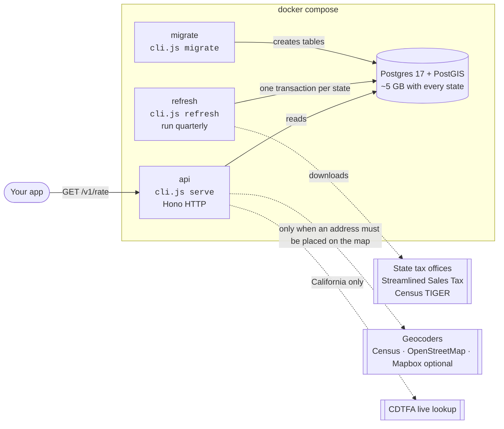
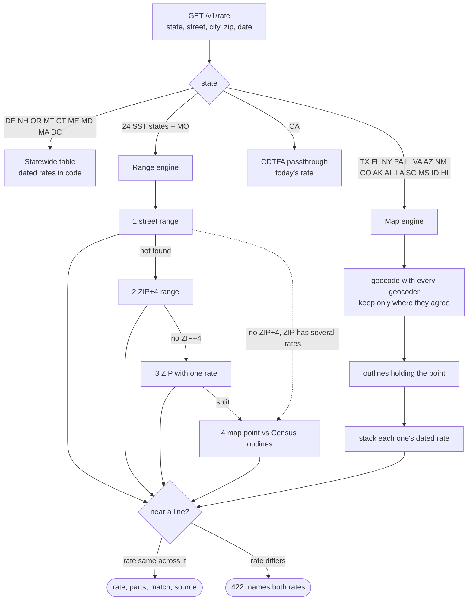
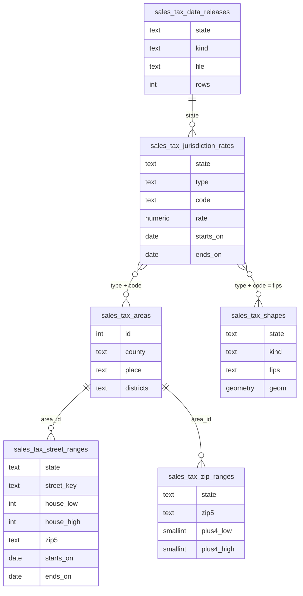

# Architecture

OpenTaxRate answers one question: **what is the general sales tax rate at this US street address on this date?** It answers from the states' own published files, loaded into Postgres, and refuses (naming the candidate rates) whenever those files can't settle a single rate.

Per-subsystem design notes, each citing the source files it describes, are in [docs/context/](context/README.md).

## Containers

The API never downloads tax datasets. It writes only the runtime geocoding cache and shared usage budgets; the refresh job owns tax data and never reads or replaces those runtime tables. Strict read-only deployments use cached geocodes only. The refresh job never answers requests. They share only the database.

## One lookup, three engines

### Range engine (Streamlined states, Missouri)

These states publish every street's house-number ranges with the county, city and districts each falls in.

1. The typed street is reduced to a **key**: type, directions, spacing and ordinals removed, highway names folded together. The state's file is read through the same function, so `3330 W McCollister Drive` and the file's `W | MCCOLLISTER | Dr` meet on `MCCOLLISTER`.
2. Ranges holding the house number on the right side of the street are narrowed by ZIP (or city), then type, direction and unit. One area means one answer.
3. Otherwise: the ZIP+4's ranges; then the ZIP, only if every range in it has one rate and the city matches; then the map.
4. A street match is also checked on the map when there is no ZIP+4 and the ZIP has more than one rate, because ranges are filed by the hundred-block and a block can straddle a city line. If the map gives a different rate, the address is refused.

Missouri publishes one total per jurisdiction code (place, county, district combination) because its parts don't always add up; that total is used as one rate.

### Map engine (everywhere else)

1. **Locate.** The locator checks permitted cached results, then asks a cheap pair of enabled providers, preferring independent datasets. The most precise dataset's point is accepted with every dataset that agrees with it, its margin widened to their spread; refused when the rest agree on another place. One dataset alone requires a typed-city containment check. Nominatim (public by default, or your own), Photon and Pelias supply OSM results. A deciding boundary triggers one refinement and a full rate recomputation at the corrected point.
2. **Contain.** PostGIS finds the outlines near the point through a spatial index, and reports for each whether it holds the point and how far the point is from its edge, in metres on the spheroid. Outlines come from the state when it publishes them (Texas, Illinois, Arizona, New Mexico, Colorado, Alaska) and from Census TIGER otherwise.
3. **Stack.** Every rate row has a type that says how it combines:

| Type | Meaning | Used by |
|---|---|---|
| `45` | state rate | all |
| `00` | county rate, county-wide | most |
| `01` | city rate, added | most |
| `01x` | city rate in place of its county's | NY own-rate cities, LA towns |
| `rc` | county rate only outside rated cities | LA parishes |
| `0c` | county's rate difference inside a named city | AL |
| `x` + `kx` | exclusive area, with what it keeps at what rate | TX cities and combined areas, IL and NM locations |
| `addr` | one street address's rate inside its area | IL business districts |
| `no`, `pj`, `maybe`, `need` | refusals stored as data | AL, LA, IL/NM |

### Near a line

For each outline whose edge is closer than the point's margin, the engine reads the rate 2 m across that edge, at the nearest point on it. Only if it differs is the address refused, with both rates in the message. Seams between pieces of one outline aren't edges: loading dissolves them, so each outline is one repaired multipolygon.

## Tables

| Table | Rows (all states) | Size | What fills it |
|---|---:|---:|---|
| street ranges | 15.4 M | 3.65 GB | SST + Missouri address ranges since 2020 |
| ZIP ranges | 5.3 M | 0.70 GB | SST + Missouri ZIP+4 and ZIP rows |
| shapes | 68 k | 0.61 GB | Census TIGER + state outlines |
| jurisdiction rates | 116 k | 20 MB | every state's dated rates |
| areas | 13 k | 2 MB | combinations of county, city, districts |

## Refresh

`cli.js refresh [STATE...]` finds each state's newest files and replaces a state's rows in one transaction, so a lookup never sees half a release. Streamlined files and Census TIGER files already loaded are skipped; Missouri and the map states are downloaded and reloaded on every run. Streamlined and Missouri street ranges stream through Postgres `COPY`, and a failure mid-file rolls the state back; map-state rates go in as batched inserts. TIGER outlines are replaced one file per transaction, and the county file covers every state.

| Kind of source | States | Cadence |
|---|---|---|
| Streamlined Sales Tax rate + boundary files | 24 | quarterly |
| Missouri DOR workbooks + boundary CSV | MO | quarterly |
| State rate files, sheets and GIS layers | TX, IL, AZ, NM, VA, AL, LA | monthly to yearly |
| Transcribed forms (dated in code) | FL, NY, PA, HI, MS, ID, SC | when the state changes them |
| State lookup service (bulk) | CO, AK | quarterly |
| Census TIGER/Line | all | yearly |
